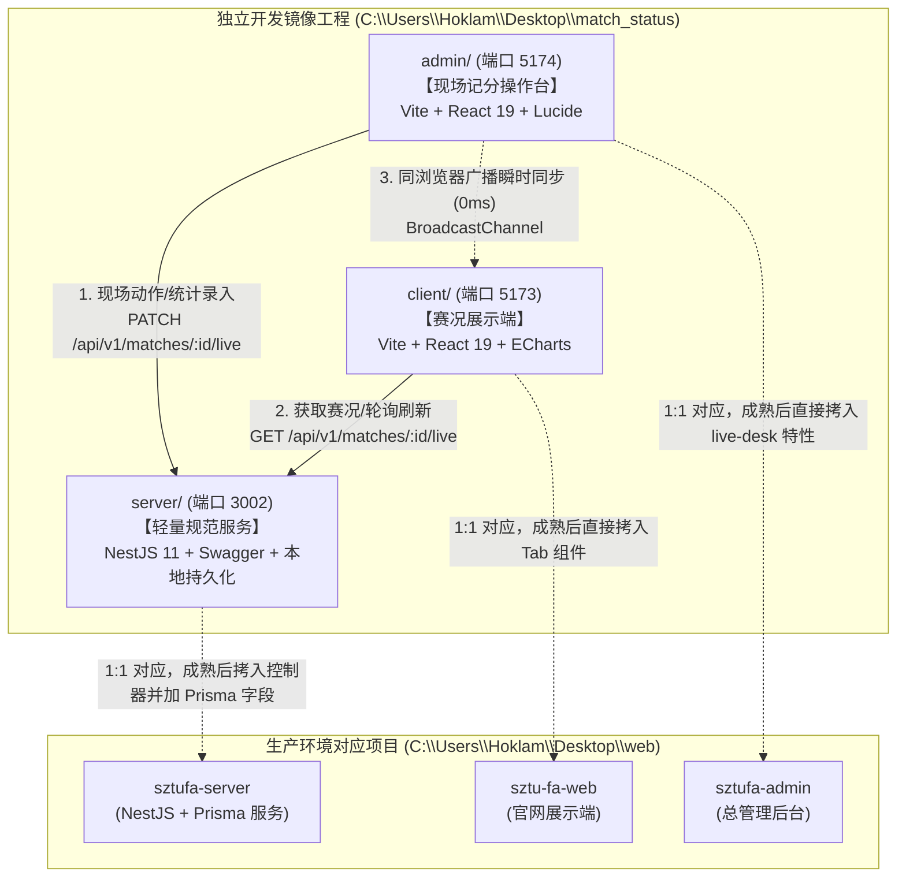
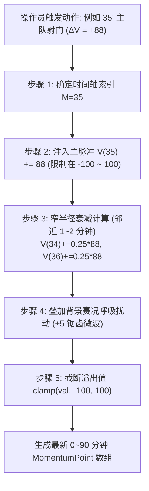
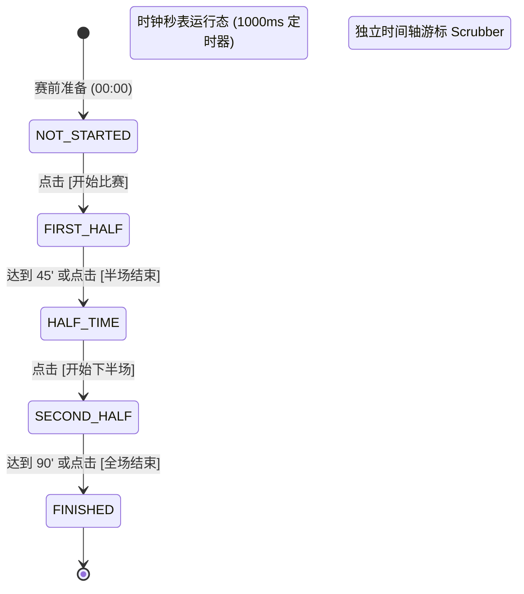
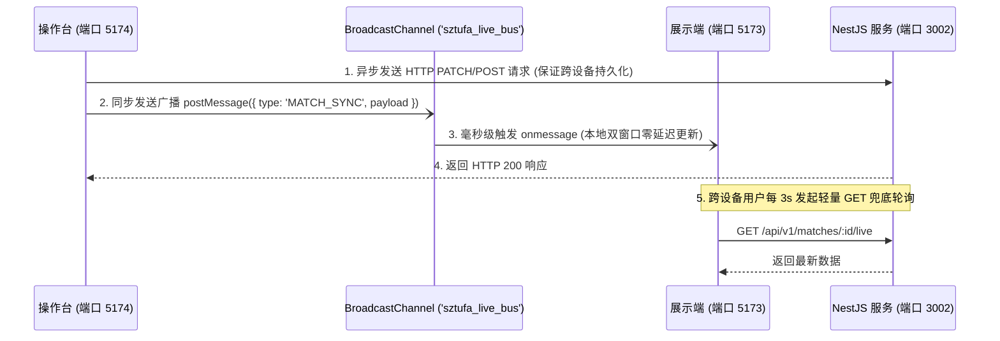

# 赛况系统（进攻心率图、技术统计与现场记录操作台）全栈实施方案与功能逻辑深度规格说明书

本方案详细规划了在 `C:\Users\Hoklam\Desktop\match_status` 目录下，建立与深圳技术大学足球协会（SZTUFA）现有系统**完全 1:1 镜像的三端独立开发架构（Client、Admin、Server）**的完整落地计划。  
本文档完整保留了现存生产三端系统的技术方案与联系机制，并在原有架构规划的基础上，全面增补了**各项功能逻辑底层的代码级实现步骤、数学算法推导、状态机流转与渲染管线细节**。

---

## 1. 业务全景与两套三端系统关系映射

### 1.1 现存生产系统（sztufa 现有三个项目）技术方案与现状分析

经深度查看与分析，现有三个项目位于 `C:\Users\Hoklam\Desktop\web` 目录下：

| 系统名称 | 目录路径 | 核心技术栈与版本 | 现有功能与架构特点 |
| :--- | :--- | :--- | :--- |
| **用户端官网**<br>(`sztu-fa-web` / `sztu-fa-web-develop`) | `C:\Users\Hoklam\Desktop\web\sztu-fa-web` | **React 19 + TypeScript + Vite 6**<br>原生 CSS 变量设计系统 (`index.css`) | 官网门户、赛程展示、积分榜、球员生涯。其比赛详情弹窗（`MatchDetailModal.tsx`）目前仅有「📝 关键事件」与「🏃‍♂️ 双方阵容」两个 Tab。通过原生 `fetch` 封装的 `apiFetch`（`src/api/http.ts`）请求 `/api/v1/matches/:id`。 |
| **总管理后台**<br>(`sztufa-admin`) | `C:\Users\Hoklam\Desktop\web\sztufa-admin` | **React 19 + TypeScript + Webpack 5**<br>Lucide-react 图标库 | 后台管理、球员球队审核、比分录入。在 `ScoreStatisticsPage.tsx` 中以表格形式事后补录进球、红黄牌、换人，缺少现场即时高频录入工具。通过 `authenticatedRequest` 带 JWT 访问 `/api/v1/*`。 |
| **后端 API 服务**<br>(`sztufa-server`) | `C:\Users\Hoklam\Desktop\web\sztufa-server` | **NestJS 11 + TypeScript 5.3 + PostgreSQL**<br>Prisma 5.7.0 ORM + Swagger | 核心数据中枢，支持 JWT 认证与角色守卫（`super_admin`, `match_scorer`）。当前数据库实体包含 `Match`, `MatchEvent`, `Goal`, `MatchLineup`，**尚未包含进攻心率波形和技术统计字段**。 |

### 1.2 现存系统的通信机制与约束
- 全站**无 WebSocket 或三方推送服务**，统一基于标准、无状态的高效 **RESTful HTTP (JSON)** 协议，统一前缀为 `/api/v1`。
- 本次新增的“赛况板块与记分操作台”严格遵循此规范，避免引入异构依赖导致未来无法合并。

### 1.3 `match_status` 独立项目与生产项目的 1:1 映射关系

为了在不破坏生产项目稳定性的前提下高效推进，在 `C:\Users\Hoklam\Desktop\match_status` 设立全镜像体系：



---

## 2. 独立工程目录组织规划 (`match_status`)

```text
C:\Users\Hoklam\Desktop\match_status\
├── IMPLEMENTATION_PLAN.md                  # 本实施规划书
├── shared/                                 # 共享契约与类型定义
│   ├── types.ts                            # 比赛、心率点、技术统计、足球动作枚举
│   └── mockMatches.ts                      # 深技大经典杯赛预设数据
│
├── client/                                 # 【赛况展示端】对标 sztu-fa-web (端口 5173)
│   ├── vite.config.ts
│   ├── package.json                        # React 19 + TypeScript + Vite + ECharts
│   ├── src/
│   │   ├── api/
│   │   │   ├── http.ts                     # 100% 移植 sztu-fa-web 的 apiFetch 规范
│   │   │   └── matches.ts                  # 请求 server 接口获取比赛与赛况
│   │   ├── components/
│   │   │   ├── MatchDetailModal/
│   │   │   │   ├── MatchDetailModal.tsx     # 还原主站弹窗框架（含 3 个 Tab）
│   │   │   │   ├── MatchModalEvents.tsx     # 关键事件（主站原有组件）
│   │   │   │   ├── MatchModalLineups.tsx    # 双方阵容（主站原有组件）
│   │   │   │   ├── MatchModalStats.tsx      # 【核心新增】第三标签页：赛况数据
│   │   │   │   ├── AttackMomentumChart.tsx  # 【核心新增】进攻心率图（Apache ECharts）
│   │   │   └── MatchStatisticsBars.tsx  # 【核心新增】10 项技术统计对比条
│   │   │   └── MatchCard.tsx                # 比赛卡片列表
│   │   ├── hooks/
│   │   │   └── useLiveMatchSync.ts          # 3s 轮询 + BroadcastChannel 双通道同步
│   │   ├── styles/
│   │   │   ├── index.css                    # 完整复用 SZTU 学院蓝/天空蓝 CSS 变量
│   │   │   └── MatchModal.css               # 与主站弹窗一致的样式
│   │   ├── App.tsx
│   │   └── main.tsx
│
├── admin/                                  # 【现场记分操作台】对标 sztufa-admin (端口 5174)
│   ├── vite.config.ts
│   ├── package.json                        # React 19 + TypeScript + Vite + Lucide-react + ECharts
│   ├── src/
│   │   ├── api/
│   │   │   ├── http.ts                     # 对标 sztufa-admin 的 fetch 客户端
│   │   │   └── matchLive.service.ts        # 调用 server 端口 3002 的 Live 接口
│   │   ├── features/
│   │   │   └── live-desk/
│   │   │       ├── LiveMatchDesk.tsx        # 沉浸式现场记录工作台主容器
│   │   │       ├── MatchClockPanel.tsx      # 比赛计时钟（走时/暂停/换半场）
│   │   │       ├── ScoreBoardBanner.tsx     # 大号比分卡与一键进球触发
│   │   │       ├── MomentumActionPanel.tsx  # 【足球动作打点】主客控球/禁区/射门/角球
│   │   │       ├── QuickStatsCounters.tsx   # 10 项统计 +1/-1 大按钮极速计数板
│   │   │       ├── OperationHistoryLog.tsx  # 操作流水栈与一键撤销（Undo）
│   │   │       └── MiniMomentumPreview.tsx  # 操作台内嵌突刺心率波形微缩预览
│   │   ├── styles/
│   │   │   ├── liveDesk.css                 # 现场记分台定制化深色/高对比度样式
│   │   │   └── adminTheme.css
│   │   ├── App.tsx
│   │   └── main.tsx
│
└── server/                                 # 【后端镜像服务】对标 sztufa-server (端口 3002)
    ├── package.json                        # NestJS 11 + TypeScript + Swagger + class-validator
    ├── tsconfig.json
    ├── nest-cli.json
    ├── src/
    │   ├── main.ts                         # 启动服务，配置 CORS、全局 /api/v1 前缀与 Swagger
    │   ├── app.module.ts
    │   ├── match/                          # 结构与 sztufa-server/src/match 完全同构
    │   │   ├── match.module.ts
    │   │   ├── match-live.controller.ts    # REST 路由：/api/v1/matches/:id/live
    │   │   ├── match-live.service.ts       # 赛况更新、突刺脉冲计算、统计联动、撤销
    │   │   ├── dto/
    │   │   │   ├── live-match.dto.ts
    │   │   │   ├── record-action.dto.ts
    │   │   │   └── update-stats.dto.ts
    │   │   └── storage/
    │   │       └── local-match-store.ts    # 轻量免安装持久化（JSON 文件存储）
    │   └── common/
    └── data/                               # 本地开发测试数据持久化目录
```

---

## 3. 核心功能设计与业务规则

### 3.1 足球实战动作打点与冲激矩阵 (`MomentumActionPanel`)

工作台将抽象数值全部转化为直观的**足球实战场景动作**。根据实际观赛需求，进攻心率图不采用过度平滑的慢速圆弧，而是**允许锐利的瞬时突刺（Spikes / Impulses）**，精准反映射门、反击与险情：

| 触发动作 | 归属方 | 心率增量 ($V$) | 自动联动技术统计 | 视觉特征与业务含义 |
| :--- | :--- | :--- | :--- | :--- |
| **主队控球** | 主队 | $+25$ | 微调控球率走向 | 持续平缓小波峰，主队组织控球 |
| **客队控球** | 客队 | $-25$ | 微调控球率走向 | 客队持续平缓小波峰 |
| **主队进入禁区** | 主队 | $+65$ | `dangerousAttacks.home + 1` | **陡峭中高尖刺**，渗透至进攻三区 |
| **客队进入禁区** | 客队 | $-65$ | `dangerousAttacks.away + 1` | **陡峭中高尖刺**，客队危险进攻 |
| **主队角球** | 主队 | $+55$ | `cornerKicks.home + 1` | 局部高位突刺，定位球机会 |
| **客队角球** | 客队 | $-55$ | `cornerKicks.away + 1` | 局部高位突刺 |
| **主队射门** | 主队 | $+88$ | `shots.home + 1`（可勾选射正） | **强力极高垂直突刺**，高威胁攻门 |
| **客队射门** | 客队 | $-88$ | `shots.away + 1`（可勾选射正） | **强力极高垂直突刺** |
| **主队进球** | 主队 | $+100$ | `homeScore + 1`, 自动生成进球事件 | **登顶尖峰突刺**，在时间轴锚定 ⚽ |
| **客队进球** | 客队 | $-100$ | `awayScore + 1`, 自动生成进球事件 | **见底尖峰突刺**，在时间轴锚定 ⚽ |
| **势均力敌/争顶** | 中立 | $0$ | 无 | 双方中场胶着互有攻守 |

---

### 3.2 10 项标准技术统计定义 (`MatchStatisticsBars`)

涵盖专业赛事核心技术数据：
1. **控球率 (`possession`)**：以百分比表示（例如 58% : 42%），双方总和 100%。
2. **射门 (`shots`)**：射门总次数。
3. **射正 (`shotsOnTarget`)**：命中球门范围内的有效射门。
4. **危险进攻 (`dangerousAttacks`)**：打入进攻三区/禁区的实质威胁攻势。
5. **角球 (`cornerKicks`)**：主客双方获得的角球数。
6. **犯规 (`fouls`)**：违规犯规受罚次数。
7. **黄牌 (`yellowCards`)**：警告黄牌张数。
8. **红牌 (`redCards`)**：直接红牌或两黄变一红罚下张数。
9. **越位 (`offsides`)**：进攻越位吹罚次数。
10. **门将扑救 (`saves`)**：守门员封堵射正的成功扑救。

---

## 4. 深度功能逻辑与代码级实现机制 (Detailed Logic Implementation)

本章节深入剖析各个板块在底层究竟**如何运算、如何流转、如何渲染**。

### 4.1 进攻心率图“突刺脉冲算法”的实现逻辑与代码流程



#### 具体实现函数 (`momentumEngine.ts`) 逻辑：
```typescript
/**
 * 突刺脉冲更新函数
 * @param currentTimeline 现有的 90 分钟波形点数组
 * @param targetMinute 发生动作的目标分钟 (1 ~ 90)
 * @param deltaV 动作冲激强度 (-100 ~ 100)
 * @param actionTag 动作标识标签
 */
export function applySpikeMomentumAction(
  currentTimeline: MomentumPoint[],
  targetMinute: number,
  deltaV: number,
  actionTag: string
): MomentumPoint[] {
  // 1. 深度拷贝防止直接修改不可变引用
  const nextTimeline = currentTimeline.map(pt => ({ ...pt }));

  // 2. 窄半径衰减系数表：让 targetMinute 产生最大突刺，邻近 1 分钟快速收敛
  // 索引偏移: -2, -1, 0, 1, 2
  const decayWeights: Record<number, number> = {
    0: 1.0,     // 目标分钟：100% 尖刺
    [-1]: 0.35, // 前 1 分钟：35% 上扬波形
    1: 0.25,    // 后 1 分钟：25% 迅速回落
    [-2]: 0.08, // 前 2 分钟：微弱过渡
    2: 0.05,    // 后 2 分钟：基本归零
  };

  // 3. 对目标区间施加高斯窄带突刺
  for (let offset = -2; offset <= 2; offset++) {
    const minute = targetMinute + offset;
    if (minute < 1 || minute > 90) continue;

    const index = nextTimeline.findIndex(item => item.minute === minute);
    if (index === -1) continue;

    const weight = decayWeights[offset] || 0;
    const impulse = deltaV * weight;
    
    // 原有值 + 冲激值，并限制在 [-100, 100]
    let newValue = nextTimeline[index].value + impulse;
    newValue = Math.max(-100, Math.min(100, Math.round(newValue)));

    nextTimeline[index].value = newValue;
    if (offset === 0) {
      nextTimeline[index].actionTag = actionTag;
    }
  }

  return nextTimeline;
}
```

---

### 4.2 Apache ECharts 可视化渲染管线与配置实现 (`AttackMomentumChart.tsx`)

#### 4.2.1 渲染管线生命周期：
1. **数据归一化**：提取 `momentumTimeline` 中的 `minute` 作为 Category X 轴，`value` 作为 Y 轴数据。
2. **事件标注转换 (MarkPoint Generation)**：
   遍历比赛事件，若存在进球 `goal`、红牌 `red_card`、黄牌 `yellow_card`：
   计算其坐标 `coord: [event.minute, momentumTimeline[event.minute].value]`，生成特殊图标锚点。
3. **双向分离面积渐变着色 (Dual LinearGradient)**：
   利用 ECharts 的 `visualMap` 或基于 0 轴的折线区域填充。由于 ECharts 面积图默认从 0 基准线开始向上/向下双向填充（`origin: 'start'`），只需为整条折线配置双色渐变：
   ```typescript
   const chartOption: echarts.EChartsOption = {
     grid: { left: 40, right: 20, top: 35, bottom: 30 },
     tooltip: {
       trigger: 'axis',
       formatter: (params: any) => {
         const pt = params[0];
         const minute = pt.name;
         const val = pt.value;
         const teamAdvantage = val > 0 
           ? `主队优势 +${val}%` 
           : val < 0 
           ? `客队优势 +${Math.abs(val)}%` 
           : '双方势均力敌';
         return `
           <div style="font-size:12px; font-weight:600;">第 ${minute} 分钟</div>
           <div style="color:${val >= 0 ? '#1A56DB' : '#EA580C'}; margin-top:4px;">${teamAdvantage}</div>
         `;
       }
     },
     xAxis: {
       type: 'category',
       boundaryGap: false,
       data: Array.from({ length: 90 }, (_, i) => `${i + 1}'`),
       axisLine: { lineStyle: { color: '#cbd5e1' } },
       axisLabel: { interval: 14 } // 每 15 分钟显示一个刻度
     },
     yAxis: {
       type: 'value',
       min: -100,
       max: 100,
       splitNumber: 4,
       axisLabel: { formatter: (v: number) => (v === 0 ? '0' : Math.abs(v)) },
       splitLine: { lineStyle: { type: 'dashed', color: '#f1f5f9' } }
     },
     series: [
       {
         name: '进攻强度',
         type: 'line',
         smooth: 0.15, // 关键：微平滑，保留折角与突刺感
         symbol: 'none',
         lineStyle: { width: 2, color: '#3b82f6' },
         areaStyle: {
           color: new echarts.graphic.LinearGradient(0, 0, 0, 1, [
             { offset: 0, color: 'rgba(26, 86, 219, 0.85)' },   // 主队深蓝
             { offset: 0.48, color: 'rgba(26, 86, 219, 0.05)' },
             { offset: 0.52, color: 'rgba(234, 88, 12, 0.05)' },
             { offset: 1, color: 'rgba(234, 88, 12, 0.85)' }     // 客队橙红
           ]),
           origin: 'auto'
         },
         markLine: {
           symbol: 'none',
           lineStyle: { color: '#94a3b8', type: 'dashed', width: 1.5 },
           data: [{ xAxis: "45'", label: { formatter: 'HT 半场', position: 'insideEndTop' } }]
         }
       }
     ]
   };
   ```

---

### 4.3 10 项技术统计对比条的计算与渲染逻辑 (`MatchStatisticsBars.tsx`)

#### 4.3.1 百分比与优势方计算规则：
对于每一项技术统计（如射门，主队 $V_H$，客队 $V_A$）：
1. **边界处理**：如果 $V_H = 0$ 且 $V_A = 0$，双方百分比均为 $50\%$，对比条显示中立浅灰，双方数值不加粗。
2. **非零比例公式**：
   $$P_H = \frac{V_H}{V_H + V_A} \times 100\%, \quad P_A = 100\% - P_H$$
3. **控球率特殊处理**：直接读取 `possession.home` 与 `possession.away`（本身即为百分比），无须累加计算。
4. **优势判定**：
   - 若 $V_H > V_A$：主队数值高亮加粗，主队进度条呈现主队主色填充；
   - 若 $V_A > V_H$：客队数值高亮加粗，客队进度条呈现客队主色填充；
   - 若 $V_H = V_A$：平分秋色，均不加粗。

#### 4.3.2 DOM 与 CSS 结构实现：
采用中心轴对齐布局：
```html
<div class="stat-row">
  <div class="stat-value home" class:highlight="isHomeAdvantage">{homeVal}</div>
  <div class="stat-bar-container">
    <div class="stat-bar-fill home" style="width: {homePercent}%"></div>
    <span class="stat-label">{label}</span>
    <div class="stat-bar-fill away" style="width: {awayPercent}%"></div>
  </div>
  <div class="stat-value away" class:highlight="isAwayAdvantage">{awayVal}</div>
</div>
```

---

### 4.4 现场记分台时钟状态机与双游标补录逻辑 (`LiveMatchDesk.tsx`)

记分台的核心在于**高并发现场下的防手忙脚乱设计**，核心逻辑由两组正交状态构成：



#### 双游标机制：
1. **走字时钟游标 (`clockMinute`)**：
   - 随系统定时器自增，严格记录比赛实际进度（如 $42:15 \rightarrow 42'$）。
2. **操作录入游标 (`scrubberMinute`)**：
   - 默认跟随 `clockMinute`；
   - **历史补录**：若记录员发现 10 分钟前有一记射门漏记，只需在时间轴拖动滑块至 $32'$，此时 `scrubberMinute = 32`。操作员在此刻点击「主队射门」，动作直接注入第 $32'$ 处波形，并使射门总数 $+1$。
   - 打点完成后，点击「回到当前时间」，游标瞬间对齐当前 `clockMinute`，比赛计时全程不受干扰。

---

### 4.5 30 步快照撤销栈 (Undo Stack) 机制

#### 实现逻辑：
```typescript
interface UndoSnapshot {
  timestamp: number;
  description: string;
  matchState: LiveMatchData;
}

export class LiveDeskHistoryManager {
  private undoStack: UndoSnapshot[] = [];
  private readonly MAX_DEPTH = 30;

  // 记录新操作前保存当前快照
  pushState(currentState: LiveMatchData, actionDesc: string) {
    if (this.undoStack.length >= this.MAX_DEPTH) {
      this.undoStack.shift(); // 移除最老快照，保持栈深不超过 30
    }
    this.undoStack.push({
      timestamp: Date.now(),
      description: actionDesc,
      matchState: JSON.parse(JSON.stringify(currentState)) // 保证完全不可变
    });
  }

  // 撤销一步
  undo(): LiveMatchData | null {
    if (this.undoStack.length === 0) return null;
    const lastSnapshot = this.undoStack.pop();
    return lastSnapshot ? lastSnapshot.matchState : null;
  }
}
```

---

### 4.6 NestJS 服务端架构与本地原子持久化 (`server`)

#### 4.6.1 架构分层：
- `match-live.controller.ts`：处理 HTTP 入口，参数 DTO 校验（`class-validator`）。
- `match-live.service.ts`：包含突刺波形计算、统计累加、重置预设等核心业务逻辑。
- `local-match-store.ts`：持久化适配器。为了避免频繁写磁盘发生文件锁冲突或损坏：
  - 内存中常驻 `Map<string, LiveMatchData>`；
  - 磁盘写入采用**防抖异步持久化 (Debounced Write)**：连续 300ms 内的多次打点合并为单次 JSON 写入，确保极速响应与数据安全。

---

### 4.7 跨端实时通讯闭环机制 (REST + BroadcastChannel)



---

## 5. RESTful 接口契约规范 (`server/src/match/`)

| 请求方法 | 路由路径 | 说明 | 请求体 / 响应 |
| :--- | :--- | :--- | :--- |
| `GET` | `/api/v1/matches` | 获取全部比赛列表（含深技大真实预设） | 返回 `LiveMatchData[]` 概览 |
| `GET` | `/api/v1/matches/:id/live` | 获取指定比赛完整实时赛况 | 返回完整 `LiveMatchData`（比分、时钟、突刺波形数组、10 项统计） |
| `PATCH` | `/api/v1/matches/:id/live` | 修改比赛状态（比分、时钟、状态） | Body: `{ homeScore?, awayScore?, period?, currentMinute? }` |
| `POST` | `/api/v1/matches/:id/live/action` | **核心**：记录现场足球动作并产生突刺脉冲 | Body: `{ minute: number, actionType: FootballActionType, onTarget?: boolean }` |
| `POST` | `/api/v1/matches/:id/live/stats-delta` | 手动修改指定统计项 $\pm 1$ | Body: `{ team: 'home'\|'away', statKey: string, delta: number }` |
| `POST` | `/api/v1/matches/:id/live/undo` | 撤销上一步操作 | 恢复至上一快照并返回最新状态 |
| `POST` | `/api/v1/matches/:id/live/reset` | 一键重置比赛数据为预设初始值 | 返回重置后的 `LiveMatchData` |

---

## 6. 后续并入原主项目（无缝迁移指南）

在 `match_status` 验证成熟后，并入原项目只需以下三步：

1. **并入 `sztufa-server`**：
   - 在 `sztufa-server/prisma/schema.prisma` 的 `model Match` 增加字段：
     ```prisma
     model Match {
       // ... 原有字段保持不变
       liveData Json?   // 存储赛况数据对象
     }
     ```
   - 运行 `npx prisma db push`。
   - 将 `match_status/server/src/match/` 下的 `match-live.controller.ts`、`match-live.service.ts` 及 DTO 复制至 `sztufa-server/src/match/`，在 `match.module.ts` 注册，将本地 JSON 读写切换为 Prisma 的 `tx.match.update`。
2. **并入 `sztu-fa-web`**：
   - 将 `client/src/components/MatchDetailModal/MatchModalStats.tsx`、`AttackMomentumChart.tsx`、`MatchStatisticsBars.tsx` 复制至 `sztu-fa-web/src/components/Matches/components/`。
   - 在已有的 `MatchDetailModal.tsx` 中增加第 3 个 Tab「📊 赛况数据」。
3. **并入 `sztufa-admin`**：
   - 将 `admin/src/features/live-desk/` 文件夹整体复制至 `sztufa-admin/src/features/`。
   - 在比赛管理页面增加「进入现场记分台」按钮即可。

---

## 7. 分步实施路线图与验收标准

| 实施阶段 | 核心任务 | 交付结果与验证标准 |
| :--- | :--- | :--- |
| **阶段 1：工程根骨架初始化** | 创建 `shared`、`server`、`admin`、`client` 目录；编写 `shared/types.ts` 与预设数据。 | 基础契约建立，类型检查通过。 |
| **阶段 2：轻量 NestJS 服务构建 (`server`)** | 初始化 NestJS 11，配置 3002 端口、防抖 JSON 文件持久化、突刺脉冲算法与全部 REST API。 | 启动服务，访问 `http://localhost:3002/api/docs` 查看并测试 Swagger 接口成功。 |
| **阶段 3：现场记分操作台开发 (`admin`)** | 构建沉浸式现场记录台、双游标时钟控制器、足球动作打点九宫格、10 项统计 +1/-1 计数器与 30 步撤销栈。 | 启动 `5174` 端口，可在操作台流畅录入动作并实时看到微缩突刺波形反馈。 |
| **阶段 4：赛况展示端开发 (`client`)** | 还原比赛详情弹窗框架，实现 ECharts 突刺心率图与 10 项统计条，接入 3s 轮询与广播加速。 | 启动 `5173` 端口，打开弹窗点击「📊 赛况数据」标签，图表完美呈现。 |
| **阶段 5：全链路双屏联调验收** | 左右屏分屏（左边开记分台，右边开展示弹窗），演示打点、撤销、突刺脉冲波形与移动端适配。 | 达成毫秒级联调效果，各项统计与图表联动 100% 正常。 |
