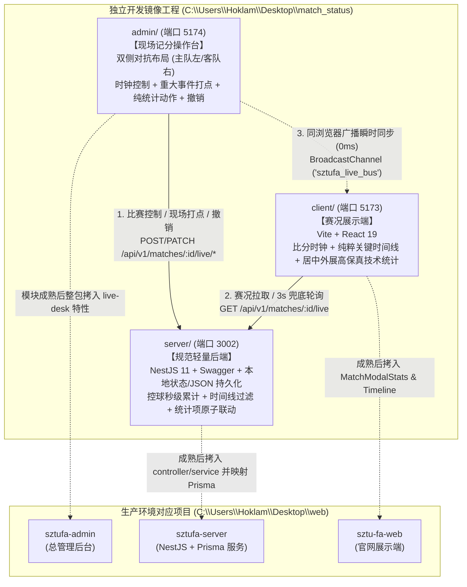

# 赛况系统（现场记录操控台、动态时间线与实时技术统计）实施方案与功能逻辑深度规格说明书

本方案基于深圳技术大学足球协会（SZTUFA）系统的 **Client、Admin、Server 1:1 独立镜像架构**，从原完整赛况方案中拆分出**第一期核心模块任务**。  
本期方案**暂缓实现进攻心率图（Waveform / Momentum Chart）**，聚焦于打通**现场记录操作台（Console / Live Desk）**与**赛况展示页（Match Live Display）**的完整数据流与交互闭环。

---

## 1. 业务全景与系统关系映射

### 1.1 模块定位与核心设计原则

- **时间线与技术统计的职责分离**：
  1. **时间线流（关键重大事件）**：仅展示**进球 ⚽（附球员备注）、红牌 🟥、黄牌 🟨、换人 🔄**，以及时段节点（开球 ⏱️、中场休息 HT、比赛结束 FT）。避免低频或碎片化的射门、角球把时间线刷屏，保持观赛时间线的清晰专业。
  2. **技术统计板块（全量数据大盘）**：
     - **视觉样式 1:1 还原用户参考图**：采用**背靠背居中外展（Center-Anchored Outward）双向条形图**：
       - 排版骨架：`[主队数值] <--- [主队条形] 【指标名称】 [客队条形] ---> [客队数值]`
       - **主队条形（左侧槽）**：起始锚点位于右侧（紧贴中间指标文字），向左侧生长延伸；
       - **客队条形（右侧槽）**：起始锚点位于左侧（紧贴中间指标文字），向右侧生长延伸。
     - **配色方案**：
       - 正向优势数据（控球率、射门、射正、角球、任意球）：领先方高亮为**深技大蓝 (`#1A56DB`)**，落后方为浅灰 (`#CBD5E1`)。
       - 负向违规数据（犯规）：数值更高的一方高亮为**警示红 (`#EF4444`)**。
       - 红黄牌数据：还原参考图设计，采用**精美矩形卡牌方块图元（🟨 🟨 🟨 vs 🟨 🟨）**直观排列展示。
     - **核心 8 项数据指标**：控球率、射门、射正、角球、任意球、犯规、黄牌、红牌。
  3. **现场操控台（双侧对抗型布局）**：
     - 界面分为**左侧主队操作区**与**右侧客队操作区**，中间为**比赛时钟大表盘、大号比分卡与控球状态指示**。
     - **重大事件按钮**（进球、红牌、黄牌、换人）：点击弹出快捷输入弹窗，录入后自动更新统计，并**同时注入时间线流**。
     - **纯技术统计按钮**（控球切换、射门、射正、角球、任意球、犯规）：点击后后台记录该事件并**即时累加技术统计板**，不占用时间线列表。

---

### 1.2 现存系统（`C:\Users\Hoklam\Desktop\web`）与独立镜像工程（`match_status`）架构映射



---

## 2. 独立工程目录组织规划 (`match_status`)

```text
C:\Users\Hoklam\Desktop\match_status\
├── MATCH_CONSOLE_TIMELINE_PLAN.md          # 本实施规划书（核心精简模块版）
├── IMPLEMENTATION_PLAN.md                  # 原始全景规划书（含心率图设计，备忘进阶）
├── shared/                                 # 共享契约与类型定义
│   ├── types.ts                            # 比赛阶段、灵活时钟模型、统计项、时间线事件类型定义
│   └── mockMatches.ts                      # 深技大经典杯赛测试预设数据
│
├── client/                                 # 【赛况展示端】对标 sztu-fa-web (端口 5173)
│   ├── vite.config.ts
│   ├── package.json                        # React 19 + TypeScript + Vite + Lucide-react
│   ├── src/
│   │   ├── api/
│   │   │   ├── http.ts                     # 100% 移植主站 apiFetch 规范
│   │   │   └── matches.ts                  # 请求 server 获取比赛与实时赛况
│   │   ├── components/
│   │   │   ├── MatchDetailModal/
│   │   │   │   ├── MatchDetailModal.tsx     # 比赛详情主弹窗框架
│   │   │   │   ├── MatchModalStats.tsx      # 【核心】赛况主标签页（时间线 + 技术统计）
│   │   │   │   ├── MatchLiveTimeline.tsx    # 【核心】关键事件动态时间线（进球/红黄牌/换人/HT/FT）
│   │   │   │   └── MatchStatisticsBars.tsx  # 【核心】居中外展高保真技术统计对比条
│   │   │   └── MatchCard.tsx                # 比赛卡片列表
│   │   ├── hooks/
│   │   │   └── useLiveMatchSync.ts          # 3s 轮询 + BroadcastChannel 双通道同步
│   │   ├── styles/
│   │   │   ├── index.css                    # 复用 SZTU 学院蓝/天空蓝设计系统
│   │   │   ├── MatchModal.css               # 弹窗与时间线定制样式
│   │   │   └── statsBars.css                # 【核心】居中外展条形图专用样式 (RTL/LTR 居中对齐)
│   │   ├── App.tsx
│   │   └── main.tsx
│
├── admin/                                  # 【现场记分操作台】对标 sztufa-admin (端口 5174)
│   ├── vite.config.ts
│   ├── package.json                        # React 19 + TypeScript + Vite + Lucide-react
│   ├── src/
│   │   ├── api/
│   │   │   ├── http.ts                     # REST 客户端
│   │   │   └── matchLive.service.ts        # 调用 3002 端口 live 相关接口
│   │   ├── features/
│   │   │   └── live-desk/
│   │   │       ├── LiveMatchDesk.tsx        # 双侧对抗布局主工作台
│   │   │       ├── MatchClockPanel.tsx      # 比赛计时钟（走字/暂停/中场弹窗确认/结束控制）
│   │   │       ├── HalfTimeConfirmModal.tsx # 中场休息确认与时间微调弹窗
│   │   │       ├── TeamActionColumn.tsx     # 单侧球队控制列（主队左 / 客队右）
│   │   │       ├── PlayerRemarkModal.tsx    # 进球/红黄牌/换人快捷文本备注录入弹窗
│   │   │       ├── TimelineEventStream.tsx  # 现场记录时间线流与编辑/删除按钮
│   │   │       ├── LiveStatsPreviewBoard.tsx# 操作台内嵌技术统计实时对比小板
│   │   │       └── PossessionIndicator.tsx  # 实时控球状态与双方持球秒数/占比显示
│   │   ├── styles/
│   │   │   ├── liveDesk.css                 # 双侧对抗高对比度抗误触样式
│   │   │   └── adminTheme.css
│   │   ├── App.tsx
│   │   └── main.tsx
│
└── server/                                 # 【轻量后端服务】对标 sztufa-server (端口 3002)
    ├── package.json                        # NestJS 11 + TypeScript + Swagger + class-validator
    ├── tsconfig.json
    ├── nest-cli.json
    ├── src/
    │   ├── main.ts                         # 启动服务，配置 CORS、全局 /api/v1 与 Swagger
    │   ├── app.module.ts
    │   ├── match/
    │   │   ├── match.module.ts
    │   │   ├── match-live.controller.ts    # REST 路由：/api/v1/matches/:id/live/*
    │   │   ├── match-live.service.ts       # 时钟状态机、事件过滤分流、控球折算、统计联动与撤销
    │   │   ├── dto/
    │   │   │   ├── live-action.dto.ts       # 现场动作提交 DTO
    │   │   │   ├── match-period.dto.ts      # 比赛时段切换 DTO
    │   │   │   └── update-stats.dto.ts      # 统计数值微调 DTO
    │   │   └── storage/
    │   │       └── local-match-store.ts    # 内存缓存 + 防抖 JSON 本地持久化
    │   └── common/
    └── data/                               # 本地开发测试数据持久化目录
```

---

## 3. 核心业务流程与功能逻辑设计

### 3.1 技术统计对比条背靠背居中外展算法与 CSS 规范 (`statsBars.css`)

严格按照确认要求：
- **主队数据条起始点在右侧**（紧贴中间指标标签，向左生长）；
- **客队数据条起始点在左侧**（紧贴中间指标标签，向右生长）；
- 两端分别是主客队具体数值。

```text
 56  [       ========]   控球率   [======         ]  44
  2  [             ==]    角球    [=====          ]   5
 11  [         ======]    射门    [============   ]  20
  3  [            ===]    射正    [====           ]   4
  8  [           ====]   任意球   [===========    ]  21
 21  [===============]    犯规    [======         ]   8   <-- 犯规多者标红！
  4  [       🟨🟨🟨🟨]    黄牌    [🟨🟨          ]   2   <-- 黄牌以芯片方块图元排列
  0  [               ]    红牌    [               ]   0
```

#### DOM 结构与样式实现：
```html
<div class="stat-row">
  <!-- 1. 主队数值（最左端） -->
  <div class="stat-value home" class:highlight="isHomeAdvantage">{homeValue}</div>

  <!-- 2. 主队进度槽（右对齐向左伸展） -->
  <div class="stat-track home-track">
    <div 
      class="stat-fill home-fill" 
      class:advantage="isHomeAdvantage"
      class:foul-negative="isHomeMoreFouls"
      style="width: {homePercent}%"
    ></div>
  </div>

  <!-- 3. 中间指标名称 -->
  <div class="stat-label">{label}</div>

  <!-- 4. 客队进度槽（左对齐向右伸展） -->
  <div class="stat-track away-track">
    <div 
      class="stat-fill away-fill" 
      class:advantage="isAwayAdvantage"
      class:foul-negative="isAwayMoreFouls"
      style="width: {awayPercent}%"
    ></div>
  </div>

  <!-- 5. 客队数值（最右端） -->
  <div class="stat-value away" class:highlight="isAwayAdvantage">{awayValue}</div>
</div>
```

#### CSS 核心样式定义 (`statsBars.css`)：
```css
.stat-row {
  display: grid;
  grid-template-columns: 36px 1fr 64px 1fr 36px;
  align-items: center;
  gap: 8px;
  margin-bottom: 12px;
}

/* 进度槽底色 */
.stat-track {
  height: 10px;
  background-color: #f1f5f9;
  border-radius: 5px;
  overflow: hidden;
  display: flex;
}

/* 主队槽：起始点在右侧，向左延伸 */
.home-track {
  justify-content: flex-end; /* 关键：子元素靠右对齐 */
}

/* 客队槽：起始点在左侧，向右延伸 */
.away-track {
  justify-content: flex-start; /* 关键：子元素靠左对齐 */
}

/* 填充条基础属性 */
.stat-fill {
  height: 100%;
  border-radius: 5px;
  background-color: #cbd5e1; /* 默认落后/持平底色（浅灰） */
  transition: width 0.35s ease;
}

/* 领先优势方颜色：深技大蓝 */
.stat-fill.advantage {
  background-color: #1A56DB;
}

/* 犯规惩罚方颜色：警示红 */
.stat-fill.foul-negative {
  background-color: #EF4444;
}

/* 黄牌、红牌方块芯片图元样式 */
.card-chip {
  display: inline-block;
  width: 10px;
  height: 14px;
  border-radius: 2px;
  margin: 0 1px;
}
.card-chip.yellow {
  background-color: #EAB308;
}
.card-chip.red {
  background-color: #EF4444;
}
```

---

### 3.2 操作台双侧对抗布局设计 (`TeamActionColumn.tsx`)

操作台界面采用清晰的**主客队左右分栏布局**：

```text
+---------------------------------------------------------------------------------------------------+
|  [中德制造学院] 2  :  1 [大数据学院]     ⏱️ 36:20 (第 37') 进行中      [暂停计时]  [中场休息]  [比赛结束]  |
+--------------------------------------------------+------------------------------------------------+
|           【左侧：主队动作控制区】               |            【右侧：客队动作控制区】            |
|                                                  |                                                |
|  [⚡ 主队控球中] (已累计 18分30秒 | 55%)          |  [⚪ 切换客队控球] (已累计 15分10秒 | 45%)      |
|                                                  |                                                |
|  [⚽ 主队进球] (弹窗选球员 -> 比分+1, 射门/正+1) |  [⚽ 客队进球] (弹窗选球员 -> 比分+1, 射门/正+1) |
|  [🎯 主队射门] (一键射门+1 / 选射正)             |  [🎯 客队射门] (一键射门+1 / 选射正)             |
|  [🚩 主队角球] (角球+1)                          |  [🚩 客队角球] (角球+1)                          |
|  [🎯 主队任意球] (任意球+1)                      |  [🎯 客队任意球] (任意球+1)                      |
|  [⚠️ 主队犯规] (犯规+1)                          |  [⚠️ 客队犯规] (犯规+1)                          |
|  [🟨 主队黄牌] (弹窗选球员 -> 黄牌+1, 犯规+1)    |  [🟨 客队黄牌] (弹窗选球员 -> 黄牌+1, 犯规+1)    |
|  [🟥 主队红牌] (弹窗选球员 -> 红牌+1, 犯规+1)    |  [🟥 客队红牌] (弹窗选球员 -> 红牌+1, 犯规+1)    |
|  [🔄 主队换人] (弹窗录入上/下场球员)             |  [🔄 客队换人] (弹窗录入上/下场球员)             |
+--------------------------------------------------+------------------------------------------------+
|  [撤销上一步 (Undo)]   【时间线流预览 (仅进球/出牌/换人)】   【技术统计实时板 (居中外展样式小屏预览)】 |
+---------------------------------------------------------------------------------------------------+
```

---

### 3.3 动作分流机制：时间线事件 VS 纯统计项

| 动作类型 | 归属方 | 录入交互 | 是否写入时间线 | 是否更新技术统计板 | 联动逻辑说明 |
| :--- | :--- | :--- | :---: | :---: | :--- |
| **主/客 进球** | 主/客 | 弹窗录入球员（姓名/号码/助攻） | **是 (⚽)** | **是** | 比分+1，`shots + 1`，`shotsOnTarget + 1`，时间线高亮显示 |
| **主/客 黄牌** | 主/客 | 弹窗录入被罚球员（姓名/号码/原因） | **是 (🟨)** | **是** | `yellowCards + 1`，`fouls + 1`，时间线展示黄牌 |
| **主/客 红牌** | 主/客 | 弹窗录入被罚球员（姓名/号码/原因） | **是 (🟥)** | **是** | `redCards + 1`，`fouls + 1`，时间线展示红牌 |
| **主/客 换人** | 主/客 | 弹窗录入换上球员、换下球员 | **是 (🔄)** | 否 | 仅在时间线记录换人时刻与球员 |
| **主/客 控球** | 主/客 | 一键点击切换 | 否 | **是** | 持续累计该队持球秒数，毫秒级折算控球率百分比 |
| **主/客 射门** | 主/客 | 一键点击（可勾选射正） | 否 | **是** | `shots + 1`（若射正则 `shotsOnTarget + 1`） |
| **主/客 角球** | 主/客 | 一键点击 | 否 | **是** | `cornerKicks + 1` |
| **主/客 任意球** | 主/客 | 一键点击 | 否 | **是** | `freeKicks + 1` |
| **主/客 犯规** | 主/客 | 一键点击 | 否 | **是** | `fouls + 1` |
| **半场节点** | 系统 | 中场弹窗确认 / 完场一键点击 | **是 (HT/FT)** | 否 | 时间线插入贯穿居中徽标节点 |

---

### 3.4 比赛时钟与中场确认算法

1. **中场休息确认**：
   - 点击【中场休息】弹出 `HalfTimeConfirmModal`；
   - 预填当前走表分钟数（如 34:20 预填 35'）；
   - 支持回车直接确认，或手动输入（如 30'、35'、40'、45'）；
   - 时间线插入节点：`[HT {minute}'] 中场休息`。
2. **下半场自适应起点**：
   - 若上半场确认时间 $\ge 45'$，下半场从 $46'$（45:01）开始计时；
   - 若上半场确认时间 $< 45'$（如 35'），下半场自动从 $36'$（35:01）开始计时。
3. **全场结束一键终结**：
   - 点击【比赛结束】无需弹窗，直接以当前表盘时间完赛，时间线插入节点：`[FT {minute}'] 比赛结束`。

---

## 4. 接口契约规范 (`server`)

| 请求方法 | 路由路径 | 说明 |
| :--- | :--- | :--- |
| `GET` | `/api/v1/matches` | 获取比赛列表（含深技大真实测试赛程） |
| `GET` | `/api/v1/matches/:id/live` | 获取指定比赛全量实时赛况（时钟、比分、8项统计、时间线） |
| `PATCH` | `/api/v1/matches/:id/live/clock` | 控制比赛时钟（开始/中场确认/下半场/完赛/暂停） |
| `POST` | `/api/v1/matches/:id/live/possession` | 切换持球方（`home` / `away` / `neutral`） |
| `POST` | `/api/v1/matches/:id/live/action` | **核心**：记录操作（进球/红黄牌/换人写入时间线并联动统计；射门/角球/任意球/犯规仅联动技术统计） |
| `DELETE` | `/api/v1/matches/:id/live/events/:eventId` | 删除时间线上进球/出牌事件，自动扣减比分与对应统计 |
| `POST` | `/api/v1/matches/:id/live/undo` | 30 步快照一键撤销（Undo 上一步） |
| `POST` | `/api/v1/matches/:id/live/reset` | 一键重置比赛数据 |

---

## 5. 分步实施路线图与验收标准

| 阶段 | 核心任务 | 交付结果与验收标准 |
| :--- | :--- | :--- |
| **阶段 1：共享契约与三端骨架搭建** | 定义包含 8 项核心统计的模型，创建 `server (3002)`、`admin (5174)`、`client (5173)`。 | 三端无报错运行，类型契约统一。 |
| **阶段 2：轻量后端分流状态机开发** | 实现事件分流（进球/出牌/换人进时间线，射门/角球/任意球/犯规仅更新统计），支持中场微调与 30 步撤销。 | Swagger 完整调通各项打点、撤销与数据回退。 |
| **阶段 3：现场记分台双侧布局构建 (`admin`)** | 构建主队左侧、客队右侧的对抗按钮布局，集成时钟、中场确认弹窗、球员录入弹窗与微型统计预览。 | 操作员左侧点主队射门统计+1，点客队进球弹窗选球员并进时间线，支持一键撤销。 |
| **阶段 4：居中外展高保真赛况展示端构建 (`client`)** | 还原 1:1 参考图风格的**背靠背居中外展条形图**（主队右起向左，客队左起向右，深技大蓝/警示红/卡牌方块图元）与关键时间线。 | 打开官网弹窗，技术统计与参考图完全一致，时间线纯粹清爽展示关键节点。 |
| **阶段 5：双端全流程实战联调** | 左右分屏联动，测试进球、出牌、射门统计、中场确认、完赛全流程。 | 0ms 实时广播秒同步，数据完全一致。 |
